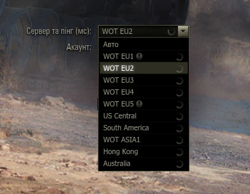

# INQ Multik

Мод для **World of Tanks**, який додає сервери **EU, NA та ASIA** до стандартного списку входу. Грай на різних регіонах з одного встановленого клієнта.

**[Завантажити останній реліз](https://github.com/Dictor1488/Multik/releases/latest)**



*Приклад вигляду меню. У поточному релізі азійський регіон представлений сервером ASIA1; окремі Hong Kong та Australia зі скриншота не додаються.*

## Можливості

- Вибір регіону через звичайний список серверів гри.
- Перемикання акаунтів різних регіонів без встановлення окремих клієнтів.
- Штатний інтерфейс і показ пінгу.
- «Авто» обирає сервер у межах останнього вибраного регіону.
- Один `.wotmod` без додаткового ядра, BAT-файлів і підміни XML гри.

## Регіони

| Регіон | Сервери, які додає мод |
|---|---|
| Європа — EU | EU1, EU2, EU3, EU4, EU5 |
| Америка — NA | US Central, South America |
| Азія — ASIA | ASIA1 |

Наявні сервери твого клієнта зберігаються. Для входу потрібен акаунт відповідного регіону; мод не переносить акаунти або прогрес між регіонами.

## Встановлення

1. Завантаж ZIP зі сторінки [релізів](https://github.com/Dictor1488/Multik/releases/latest).
2. Видали попередню версію Multik та інші моди перемикання регіонів.
3. Розпакуй ZIP у папку World of Tanks.
4. Запусти гру, вибери сервер і введи дані акаунта потрібного регіону.

Для WoT **2.4.1.1** пакет має лежати в `mods/2.4.1.1/`. Якщо встановлено стару XML-підміну RaJCeL для зміни регіонів, її також потрібно прибрати.

Щоб змінити акаунт, від'єднайся від сервера та повернися на екран входу. При переході в інший регіон гра може попросити ввести пароль повторно.

## Сумісність

Перевірено на **WoT 2.4.1.1**: вхід на EU, ASIA та NA, перехід ASIA → NA без перезапуску, завантаження бою на NA. Повний цикл між усіма регіонами без перезапуску та міжрегіональні WGC/Steam окремо не підтверджені.

Після оновлення гри потрібна актуальна папка `mods/<версія>/`. Якщо WG змінить внутрішні методи входу або адреси серверів, мод може потребувати оновлення.

RU/Lesta, CN і тестові сервери не підтримуються. Додаткові регіональні моделі та стилі до пакета не входять.

## Збірка з вихідного коду

Ігрова логіка міститься в одному файлі: `python/gui/mods/mod_multik.py`.

Для збірки потрібні **Python 3.8+** і компілятор **Python 2.7**. Шлях до Python 2.7 задається в `build.json`, змінній `PYTHON2` або параметрі `--python2`.

```bash
python build.py --distribute
```

Готовий `.wotmod` і ZIP для встановлення з'являться в `build/`. Збирач перевіряє версію компілятора та вміст пакета.

## Зворотний зв'язок

Про помилки повідомляй у [Issues](https://github.com/Dictor1488/Multik/issues): вкажи версію гри, регіон і кроки відтворення. Повідомлення мода в журналі мають префікс `[INQ Multik]`. Перед публікацією журналу прибери токени авторизації та особисті дані.

[Історія поточного релізу](RELEASE_NOTES.md)
